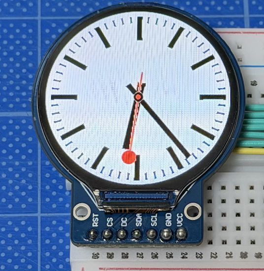
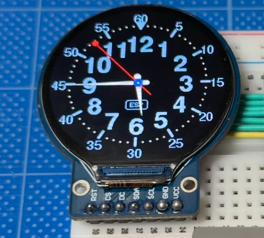

# ESP32 + GC9A01 円形ディスプレイで、アナログ時計

文字盤は次の2種類が選べます





* 黒背景・水色の大きな数字・外周の分表示・▼マーク・ロゴ枠
* スイスの鉄道時計風のデザイン（白背景）
`PlatformIO` の環境`(env)`で切り替えられます。

## コントローラと文字盤の切り替え
 コントローラを`ESP32-C3 Super Mini`, `Seeed XIAO ESP32C3`, `ESP32 MiniKit (MH-ET LIVE)` を選んでビルドできます。
 さらに文字盤を2種から選べます。
 
### 使える環境 (env):
* supermini           ESP32-C3 Super Mini / 青い文字盤   ← 既定
* supermini_railway   ESP32-C3 Super Mini / 鉄道時計風の文字盤
* xiao_c3             Seeed XIAO ESP32C3 / 青い文字盤
* xiao_c3_railway     Seeed XIAO ESP32C3 / 鉄道時計風の文字盤
* mhetesp32minikit    ESP32 MiniKit (MH-ET LIVE) / 青い文字盤
* railway             ESP32 MiniKit (MH-ET LIVE) / 鉄道時計風の文字盤

コントローラに合わせて、`PlatformIO.ini` のピン設定を確認してください。


## 文字盤の切り替え方
* `platformio.ini` に 上記の6種があります。
* `VS Code` 下部の環境選択(または `pio run -e railway -t upload`)で切り替えられます。
* * コントローラ名だけのものを選ぶ（ディフォルト）と、黒背景の青い文字盤です。
* `_railway` がついたものを選んで書き込むと、スイスの鉄道時計風の文字盤になります。
* 起動ログの `[BOOT] watch face:` に、どちらの文字盤か表示されます。

## 配線(GC9A01 → ESP32 MiniKit)
配線（ESP32のピン番号)は `PlatformIO.ini` の使用する `ENV:`で設定できますので、やりやすい配線に合わせて書き換えて使用してください。

例えば
```cpp
    -DTFT_MOSI=17    // SDA
    -DTFT_SCLK=16    // SCL
    -DTFT_CS=22
    -DTFT_DC=21
    -DTFT_RST=27
    -DTFT_BL=32      // 配線なし
```
　VCC には `3.3V`、`GND`は`GND`に配線します。

 ## 調整ポイント

* 色が赤と青で逆になる場合: `platformio.ini` の `-DTFT_RGB_ORDER=TFT_BGR` のコメントを外します。
* 数字の縦位置がずれる場合: `NUM_DY` を調整します。
* 秒針の動き: `SMOOTH_SECOND` で、滑らかに動かすか、1 秒ごとにカチッと動かすかを切り替えます。
* 描画が重い場合: `SPI_FREQUENCY` を `80000000` に上げられます。表示が乱れたら `40000000` に戻してください。
* 向きが違う場合: `tft.setRotation()` を変えます。

## 文字盤を調整したい場合

* 時針・分針の太さは `drawClockStripBlue` 内の `drawHand(hDeg, 52, 10, 9.0f, TIP_W, …)` と `drawHand(mDeg, 86, 12, 7.0f, TIP_W, …)` の 4 番目の数値です。
* 秒針の太さは同じ関数内の `drawHand(sDeg, SEC_TIP_R, 26, 2.0f, 2.0f, …)` の `2.0f` です。
* 針が細すぎる、または円が大きすぎると感じたら、`fillSmoothCircle` の半径`(4)`を `3` にするのも手です。

## 調整
文字盤のデザインや運針と、鉄道時計風の動き（秒針が12時で 1.5秒停止）が設定で変更できます。

### 文字盤のデザインと運針
```cpp
static const bool  SMOOTH_SECOND = true;         // true: 秒針が滑らか / false: 1秒ごと
static const char* LOGO_TEXT = "ESP";
static const int   NUM_DY = 2;                   // 数字の縦位置の微調整(px)
static const uint32_t HEARTBEAT_MS = 10000;      // 状態ログの出力間隔
```
### 鉄道時計風の動き
```cpp
// 秒針の 12 時停止(鉄道時計風)。SMOOTH_SECOND = true のときだけ有効
static const bool  STOP_AT_12_RAILWAY = true;    // 鉄道時計風の文字盤
static const bool  STOP_AT_12_BLUE    = false;   // 青い文字盤
static const float SWEEP_SECONDS      = 58.5f;   // 1周にかける秒数(残りの時間は12時で停止)
```
